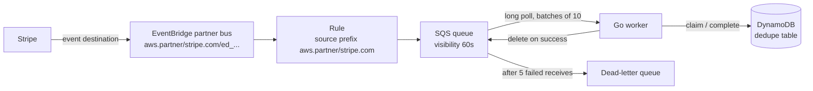

# stripe-eventbridge-sqs-go

A Go template for processing Stripe events that arrive through Stripe's [Amazon EventBridge integration](https://docs.stripe.com/event-destinations/eventbridge) instead of a webhook endpoint:

**Stripe → EventBridge partner bus → EventBridge rule → SQS queue (with a dead-letter queue) → Go worker**

The worker long-polls SQS, parses the EventBridge envelope into a normal `stripe.Event`, skips events it has already handled, and leaves anything that fails on the queue so SQS retries it and eventually parks it in the DLQ. Everything runs locally against [LocalStack](https://github.com/localstack/localstack), so you can try the whole thing without touching a real AWS or Stripe account.

It uses the same example handlers and idempotency approach I'd use for plain webhooks. If you've read [5 Stripe Integration Mistakes That Cost Startups Money](https://bonniedoone.ai/blog/stripe-integration-mistakes), a lot of this will look familiar. It's the same advice, just with a queue in the middle.

## Why EventBridge and SQS instead of webhooks?

With a webhook, Stripe makes an HTTP request to your server and waits for a reply. That's fine until your server is slow, deploying, or down. Then you're relying on Stripe's retries, and you have to keep a public endpoint up and verify signatures on every request.

With EventBridge, Stripe puts events straight into your AWS account. From there, SQS holds onto them until your worker is ready:

- **Nothing to expose.** There's no public URL to protect and no signature to check. Events arrive through AWS, not over the internet to your app.
- **Your worker can be down.** Deploys, crashes, and slow databases just mean messages wait in the queue a bit longer.
- **Retries and a DLQ for free.** SQS redelivers failed messages, and after a few tries moves them to a dead-letter queue where you can look at them instead of losing them.
- **You control the pace.** The worker pulls work when it has capacity, so a burst of events doesn't turn into a burst of database load.

Plain webhooks are completely fine for a lot of apps, and I'd still start there if you're small, not on AWS, or only care about a handful of event types. A webhook endpoint is one HTTP handler. This setup is a bus, a rule, two queues, a table, and a worker. If you don't need the extra moving parts, a well-built webhook endpoint is the simpler choice.

A couple of things EventBridge can't do: you can't use it for `issuing_authorization.request` (Stripe needs a real-time reply), and delivering `checkout.session.completed` through EventBridge doesn't affect Checkout's redirect behavior. Stripe's docs cover both.

## How it fits together



Locally, LocalStack plays the AWS parts and one of two things plays Stripe: a sample-event command, or a small forwarder that takes webhooks from `stripe listen` and puts them on the local bus.

### What lands in the queue

Stripe's EventBridge destination wraps the regular Stripe `Event` JSON in EventBridge's own envelope, with the Stripe event under `detail`. This is trimmed from the example in [Stripe's docs](https://docs.stripe.com/event-destinations/eventbridge#event-structure):

```json
{
  "version": "0",
  "id": "17e8dff5-d6cd-3770-ace9-aeac02b6ac3f",
  "detail-type": "customer.created",
  "source": "aws.partner/stripe.com/ed_61PgtRTG5aTCIz98516PLsRGLISQK0Otk6FWKjBrcDia",
  "account": "506417113029",
  "time": "2024-03-07T18:27:56Z",
  "region": "us-west-2",
  "resources": ["arn:aws:events:us-west-2::event-source/aws.partner/stripe.com/ed_61Pg..."],
  "detail": {
    "id": "evt_1OrlfcFvFEcV7KhhYdemHC4q",
    "object": "event",
    "api_version": "2023-10-16",
    "type": "customer.created",
    "data": { "object": { "id": "cus_Ph9zopzZYifGvU", "object": "customer" } }
  }
}
```

An EventBridge rule with an SQS target puts that whole envelope in the message body. The full version of that docs example is the test fixture in `internal/events/testdata`.

The parser is a little defensive, because a few things aren't pinned down by the docs:

- **Use `detail.id` for dedupe, not the top-level `id`.** The top-level one is EventBridge's ID. Stripe's own guidance is to track event IDs to spot duplicates.
- **`detail.type` wins.** `detail-type` should always match it, but if they ever disagree the worker logs a warning and goes with the Stripe event.
- **Bare events work too.** If you add an input transformer of `$.detail` to the rule, the queue gets just the Stripe event, and the parser handles that.
- **Thin events are rejected.** Stripe destinations can send thin events (`"object": "v2.core.event"`) instead of full snapshots. This template is built for snapshot events, so a thin event fails parsing and ends up in the DLQ instead of being silently dropped. Pick snapshot events when you create the destination.
- **The API version is checked.** stripe-go only decodes events from its own API release reliably, so the parser rejects other releases by default, same as stripe-go's webhook package. `events.WithIgnoreAPIVersionMismatch()` turns that off if you've checked the fields you read.

## Quick start with LocalStack

You'll need Go 1.27.3 or newer (with the default GOTOOLCHAIN=auto, an older Go fetches it for you) and Docker. That's it for the first path.

```sh
make localstack-up      # starts LocalStack and creates the bus, rule, queues, and table
make run-worker         # in one terminal
```

`localstack-up` waits until the init script in `localstack/init/` has finished. If port 4566 is already in use on your machine, run everything with `LOCALSTACK_PORT=4567 make ...`.

LocalStack is pinned to `4.14.0` in `docker-compose.yml`. The newer `2026.x` images won't start without a LocalStack auth token, and I wanted this to run with no sign-up.

### Path 1: send a sample event

In another terminal:

```sh
make sample                               # checkout.session.completed
make sample TYPE=invoice.payment_failed
make sample TYPE=customer.subscription.deleted
```

The sample command puts a realistic Stripe event on the local bus, wrapped exactly the way Stripe wraps it. The worker logs pick it up within a second or so.

To watch the duplicate handling, send the same event ID twice:

```sh
make sample ID=evt_test_duplicate
make sample ID=evt_test_duplicate
```

The first one gets processed. The second one gets `skipping duplicate event`.

### Path 2: real test-mode events with the Stripe CLI

Stripe can't deliver to LocalStack, so `cmd/forwarder` stands in for Stripe's EventBridge destination. It receives webhooks from `stripe listen`, verifies the signature, and calls `PutEvents` on the local bus with the same `source`, `detail-type`, and `detail` that Stripe uses. Everything after that is identical to production.

You'll need the [Stripe CLI](https://docs.stripe.com/stripe-cli) logged in to a test-mode account.

```sh
# 1. Forward test-mode webhooks to the forwarder. This prints a whsec_... secret.
#    --latest sends events in the newest API version, which is what stripe-go expects.
stripe listen --latest --forward-to localhost:8081/stripe

# 2. In another terminal, start the forwarder with that secret.
STRIPE_WEBHOOK_SECRET=whsec_... make run-forwarder

# 3. Make something happen in test mode, e.g.
stripe trigger checkout.session.completed
```

You should see the forwarder log `forwarded event` and the worker log `processed event`. If the forwarder rejects events because of the API version, check that you passed `--latest`, or set `STRIPE_IGNORE_API_VERSION_MISMATCH=true` if you know what you're doing.

The forwarder is for local development only. It uses a `source` that starts with `aws.partner/stripe.com`, which LocalStack allows and real AWS doesn't (only Stripe can publish to a partner bus). That's on purpose: it keeps the local rule identical to the production one.

### Tests

```sh
make test               # unit tests with the race detector
make test-integration   # needs `make localstack-up` first
make lint
```

The integration tests send an event through EventBridge and check the worker handles it once even when it's delivered twice, check the DynamoDB claim under concurrency, and push a bad message through a throwaway queue to watch it land in the DLQ.

## Retries, the DLQ, and idempotency

This is the part worth understanding before you put real money through it.

**Success deletes, failure does nothing.** When your handler returns `nil`, the worker deletes the message (in batches of up to 10). When it returns an error, the worker just leaves it. There's no retry loop in the code. SQS already has one:

1. Receiving a message hides it for the queue's visibility timeout (60 seconds here).
2. If nobody deletes it in that time, it becomes visible again and gets received again.
3. Each receive bumps a counter. Once it passes `maxReceiveCount` (5 here), the redrive policy moves the message to the DLQ.

So a message that fails five times in a row ends up in `stripe-events-dlq`, where it'll sit for 14 days. Keep the handler timeout (30 seconds) comfortably under the visibility timeout, or a slow message can reappear while it's still being worked on. Messages the worker can't parse at all go the same way, which means a misconfigured destination shows up in the DLQ instead of vanishing. `make dlq` shows what's in there locally.

When you've fixed whatever was failing, you can move messages back with SQS's built-in DLQ redrive (in the console, or `aws sqs start-message-move-task`).

**Duplicates are normal.** You will see the same Stripe event more than once. Stripe retries deliveries for up to three days, the AWS docs say an EventBridge rule can occasionally fire more than once for a single event, and SQS standard queues are at-least-once, so the same message can be received twice. Order isn't guaranteed either.

That's why every event goes through an `EventStore` before your handler runs:

- **Claim** writes "in progress" for the Stripe event ID. Only one worker can win this. The DynamoDB store does it with a conditional `PutItem` (`attribute_not_exists(event_id)`), so two workers racing on the same event can't both get through.
- **Complete** marks it done after your handler succeeds. Later copies are skipped and deleted.
- **Release** removes the claim after a failure, so the retry isn't mistaken for a duplicate.

Records get a TTL (`expires_at`) of four days, a bit longer than Stripe's retry window, and DynamoDB deletes them on its own after that.

One thing I added here that the webhook repo doesn't need as much: a claim has a lease. If a worker gets killed mid-event (an OOM, a hard kill, a lost node), it never calls Release. Without a lease, that event would be stuck "in progress" and every retry would be thrown away as a duplicate. With one, a claim older than 45 seconds is treated as abandoned and the next delivery can take over.

If `DEDUPE_TABLE` isn't set, the worker uses an in-memory store. That's fine on your laptop, but it forgets everything on restart and isn't shared between workers, so set the table in production.

**Shutting down.** On SIGINT or SIGTERM the worker stops receiving, finishes whatever it already has in hand, deletes the successes, and exits. Anything it didn't finish just becomes visible again after the visibility timeout.

## Deploying to real AWS

### 1. Connect Stripe to EventBridge

Follow [Stripe's EventBridge guide](https://docs.stripe.com/event-destinations/eventbridge). The short version:

1. In the Stripe Dashboard, enable Workbench, then go to **Workbench → Webhooks → Create new destination**. Pick your event types, choose **Amazon EventBridge**, and enter your AWS account ID and region. Choose snapshot events, and set the API version to the one your stripe-go version expects (`stripe.APIVersion`, which is `2026-09-30.endive` for stripe-go v87.0.0).
2. Stripe creates a partner event source in that AWS account named `aws.partner/stripe.com/ed_...`. You have **7 days** to associate it with an event bus, or AWS deletes it and Stripe disables the destination.

### 2. Create the bus, rule, queues, and table

`deploy/terraform/main.tf` is a minimal **example**, not a production module. It creates:

- the partner event bus, associated with Stripe's event source
- a rule on that bus matching `source` prefix `aws.partner/stripe.com`
- the SQS queue and DLQ with a redrive policy (`maxReceiveCount` 5)
- a queue policy that lets only that rule send to the queue
- the DynamoDB dedupe table with TTL on `expires_at`

```sh
cd deploy/terraform
terraform init
terraform plan \
  -var region=us-east-1 \
  -var stripe_event_source_name=aws.partner/stripe.com/ed_...
```

I've checked it with `terraform validate` and `terraform fmt -check`, but I haven't applied it to a real account as part of building this repo, so read it and run a plan before you apply. Things you'll probably want to add: CloudWatch alarms on the DLQ depth, an EventBridge archive so you can replay events (Stripe recommends one, since you can't resend EventBridge events from the Dashboard), and a dead-letter config on the rule target for events EventBridge itself can't deliver to SQS.

### 3. Run the worker

Build the image with the included `Dockerfile` and run it wherever you run containers (ECS, EKS, a VM). It needs:

| Variable | What it's for |
| --- | --- |
| `QUEUE_URL` | Required. The queue from the Terraform output. |
| `AWS_REGION` | The queue's region. |
| `DEDUPE_TABLE` | The DynamoDB table. Leave it unset only for local testing. |
| `CONCURRENCY` | Polling loops, default 2. Each handles up to 10 messages at a time. |
| `LOG_LEVEL` | `debug`, `info` (default), `warn`, or `error`. |
| `AWS_ENDPOINT_URL` | Only for LocalStack. Leave it unset in AWS. |

The worker's IAM role needs `sqs:ReceiveMessage` and `sqs:DeleteMessage` on the queue, and `dynamodb:PutItem` and `dynamodb:DeleteItem` on the table.

To handle your own events, register handlers on the dispatcher the same way `internal/billing` does:

```go
dispatcher.On(stripe.EventTypeInvoicePaid, func(ctx context.Context, e stripe.Event) error {
	var invoice stripe.Invoice
	if err := json.Unmarshal(e.Data.Raw, &invoice); err != nil {
		return err
	}
	return markPaid(ctx, invoice.ID)
})
```

Return an error and the message gets retried. Return `nil` and you're done. Event types with no handler are acknowledged and deleted, so they don't pile up.

## Project layout

```
cmd/worker            wires config from env and runs the SQS worker
cmd/forwarder         local only: stripe listen -> verify signature -> PutEvents
cmd/sample            local only: puts a sample Stripe event on the bus
internal/worker       SQS long polling, batches, delete on success, graceful shutdown
internal/events       envelope parsing, dispatch by type, EventStore + in-memory store
internal/dynamostore  EventStore on DynamoDB (conditional PutItem + TTL)
internal/billing      example handlers that turn events into account changes
internal/publish      builds Stripe-shaped PutEvents entries (forwarder and sample)
internal/samples      realistic sample events used by cmd/sample and the tests
integration           LocalStack tests (go test -tags integration)
localstack/init       creates the bus, rule, queues, policy, and table on startup
deploy/terraform      example infrastructure for real AWS
```

## License

MIT. See [LICENSE](LICENSE).

---

Built by [Bonnie Doone Consulting](https://bonniedoone.ai). Need help with payments infrastructure? [Let's talk](https://bonniedoone.ai/services/api-stripe-integrations).
